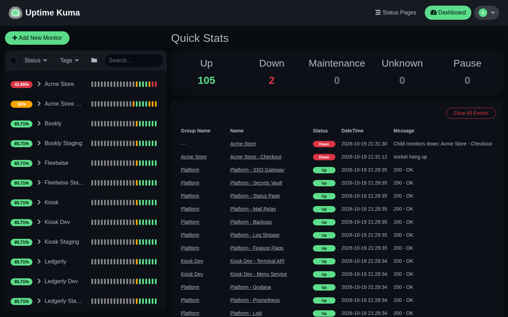

# uptime-kuma-as-code

Declare your [Uptime Kuma](https://github.com/louislam/uptime-kuma) monitors in one JSON file, then apply it. Groups, monitors and Discord alerts are created or updated to match the file, and running it twice changes nothing.



Uptime Kuma has no REST API for its configuration: API keys only unlock `/metrics`. This tool talks to the same Socket.IO API the web UI uses, with a regular login. Tested against Uptime Kuma 2.5.

## Why

Adding monitors by hand is fine for ten of them. With 70+ across production and staging, it is slow, error-prone, and if the instance loses its database you start over. Here the file is the source of truth: a new server is one `apply` away.

## Quick start (local playground)

The repo ships a playground: Uptime Kuma on MariaDB, plus a simulator that answers like 100+ applications, so you can try everything without probing anyone's servers.

```bash
cp .env.example .env          # set a password, a Discord webhook, MONITORS_FILE=monitors.example.json
docker compose up -d
npm install
npm run setup                 # creates the admin account on the fresh instance
npm run plan                  # shows what would be created
npm run apply                 # 101 monitors and 15 groups, about 15 seconds
```

Open http://localhost:3001, then break something:

```bash
npm run chaos -- down acme-store/production/checkout-web   # connection reset
npm run chaos -- error acme-store/staging                  # every staging service returns 500
npm run status                                             # what is UP, DOWN, PENDING
npm run chaos -- reset
```

Production alerts go to one Discord channel and mention your team, staging alerts go to another, quietly.

## Commands

| Command | What it does |
| --- | --- |
| `npm run setup` | Creates the admin account from `.env` on a fresh instance |
| `npm run healthcheck` | Checks the connection and the credentials |
| `npm run plan` | Shows what `apply` would create or update, writes nothing |
| `npm run apply` | Applies the file |
| `npm run prune` | Applies, then deletes monitors that are not in the file |
| `npm run status` | Lists monitors by their last heartbeat |

Requires Node.js 22.18 or later (TypeScript runs as is, no build step).

## The monitors file

```jsonc
{
  "defaults": { "type": "http", "interval": 30, "retryInterval": 20, "maxretries": 1, "timeout": 24 },
  "environments": {
    "production": { "notification": "discord-prod" },
    "staging": { "notification": "discord-staging", "overrides": { "interval": 120, "maxretries": 2 } }
  },
  "notifications": [
    { "key": "discord-prod", "name": "Discord Production", "type": "discord",
      "webhookEnv": "DISCORD_WEBHOOK_PROD", "mentionsEnv": "DISCORD_MENTION_IDS" },
    { "key": "discord-staging", "name": "Discord Staging", "type": "discord",
      "webhookEnv": "DISCORD_WEBHOOK_STAGING" }
  ],
  "groups": [
    {
      "name": "Acme Store",
      "monitors": [
        { "name": "Checkout", "url": "https://checkout.acme.example/health", "env": "production" },
        { "name": "Storefront", "url": "https://acme.example", "env": "production",
          "type": "keyword", "keyword": "Add to cart" }
      ]
    }
  ]
}
```

- **defaults** apply to every monitor, **environments.overrides** on top, then the monitor's own fields.
- Each **environment** routes its alerts to one notification.
- A monitor is named `<group> - <name>` in Kuma. That name is how the next run finds it again: rename it in the file and you get a new monitor plus an orphan, which `prune` removes.
- Secrets stay in `.env`: the file only holds the names of the variables.
- Any Kuma HTTP field can be set per monitor (`method`, `accepted_statuscodes`, `keyword`, `headers`, `ignoreTls`...). See `KUMA_FIELDS` in [src/config.ts](src/config.ts).

## Things worth knowing about Kuma's Socket.IO API

- **Wait for `info` before emitting.** The server registers its handlers after sending `info`; anything sent earlier is silently dropped and the call hangs.
- **Log in once per run.** Logins are rate-limited (20 per minute).
- **Only send known fields.** `add` imports every key it receives as a database column.
- **`editMonitor` overwrites everything.** A field missing from the payload is reset, so send the full existing monitor with your changes on top.
- **Discord mentions are `<@id>`.** Written without the `@`, Discord prints the number and pings nobody. Keep the default message format: a custom template replaces the rich embed with plain text.
- **No external ID.** Monitors can only be matched by name.

## License

MIT
